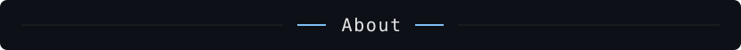

<h1 align="center">Hi, I'm Markus Harnúšek</h1>

  

I'm a software engineering student at HTL Leonding, building embedded systems and desktop software. I've been programming since I was seven, starting with Scratch at CoderDojo Linz and working my way to TypeScript, Arduinos and ESP32s.

Today I run the school's Embedded Systems Club, where I want to help others discover the same passion and bring people together around new projects. In August 2026 I interned at BMD, working on an automated project scheduling tool.

The languages, frameworks and tools I've worked with, from daily drivers to things I'm still exploring.

  

  

<h3 align="center">GoalFinder: basketball for blind and visually impaired players</h3>

An open-source device that mounts on a basketball hoop. It plays a sound so players can find the basket, and gives sound and light feedback on every hit and miss. Florian Hetzmann and I took it over at the end of 2025 to turn a working prototype into something a school can use every day.

  

  <a href="https://goalfinder.github.io/">Website</a> ·
  <a href="https://goalfinder.github.io/documentation">Documentation</a>

A selection of my smaller projects: web tools and C# desktop utilities.

  
  

  
  

  

Get in touch to learn more about me and my work. Email is the best way to reach me. I'd love to hear from you.

  <a href="mailto:m.harnusek@students.htl-leonding.ac.at"><code>m.harnusek@students.htl-leonding.ac.at</code></a>

